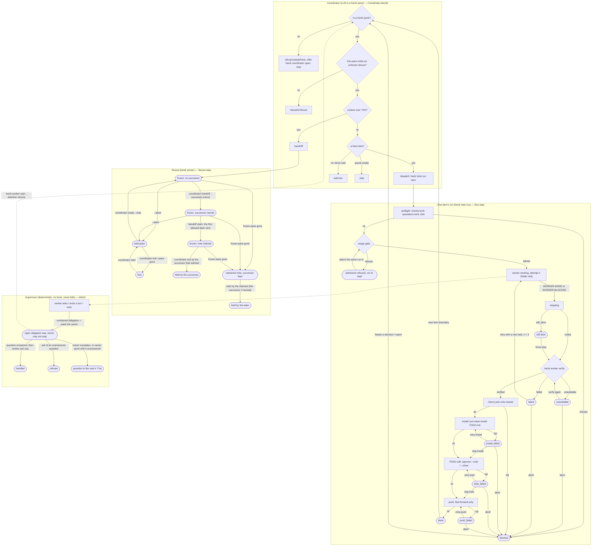

# TODO workflow model

A hand-written model of how a repository's TODO is worked through with herdr:
the coordination tenure and its handoff, one item's run through
`herdr todo run`, the supervisor that watches a worker for its owner, and the
coordinator's decision at an item boundary.

**These proofs establish properties of this model only.** `TodoWorkflow.lean`
was written by hand on 2026-10-23 (at commit `8400a511e`; revised after consult rounds `20261023-133232-9be6`, `20261023-134902-c328` and `20261023-135828-a549`) from `AGENTS.md`,
`DECISIONS.md`, `.herdr/checks.toml`, the CLI help and the global `todo` and
`handoff` skills. It is not extracted from the Rust code, and nothing checks
that the code still matches it. The Rust code and its tests are the source of
truth; the diagram below only illustrates the model. Consult round
`20261023-132611-0125` chose this place and form.

## Check

```sh
lean docs/todo-workflow-model/TodoWorkflow.lean   # Lean 4.34.0, no Mathlib
```

It prints the one `#eval` (`TodoWorkflow.Action.dispatch "t-b"`) and nothing
else when every theorem holds. Lean is not part of `just check`.

## What it proves

Over any sequence of events, not just one step:

- Nothing lands (cherry-pick, install, TODO edit, push, done) without a
  `verified` verdict (`landing_needs_verified`, `done_needs_verified`), and
  landing is a trap: no step goes back to a worker or a verify
  (`landing_is_trap`, `landing_stays`).
- No run from preflight reaches a fourth attempt
  (`attempts_bounded_from_preflight`).
- A question a worker asks is never lost: it stays an open obligation, goes
  to the user, or is answered and acknowledged (`question_never_lost`).

For single steps:

- Only the holder ends a tenure; any tenure that is not free refuses a plain
  start; the holder names one successor, never itself; the note's claim is
  exclusive and only an allowed taker (not the frozen pane, and the named
  successor when there is one) can win it, so a wrong claim cannot block the
  handoff; only the named successor that won the claim acks; after the
  frozen pane is gone only the claimant takes over.
- A refused admission waits for the same run's attach.
- The supervisor: obligations are numbered, and answers, escalations and
  acknowledgements name the number; every worker event wakes the owner and
  blocks its stop until acknowledged; an unanswered question cannot be
  acknowledged away;
  when the owner goes away every unanswered question reaches the user.
- The coordinator dispatches only from its own pane holding an unfrozen tenure.

Assumed, not proved: run and item identity, branch heads and ancestry.

## Where it maps to the code

| Model | Code |
|---|---|
| `Tenure`, `Tenure.step` | `src/workers/coordinators.rs`, `src/workers/coordinator_handoff.rs`, `src/cli/coordinator.rs` |
| handoff note claim | `src/cli/handoff.rs` |
| `Run`, `Run.step` | `src/workers/runs/` (`finish.rs`: install, TODO edit, push), `src/cli/todo.rs` |
| verify | `src/workers/verify/`, `.herdr/checks.toml` |
| `Watch` (the supervisor) | `src/workers/supervisor/questions.rs` (questions, escalation), worker wait/ack and the Stop hook |
| `Coordinator.decide` | the global `todo` skill (agent-kit), not herdr code |

`Watch` is the supervision the global rules describe (a deterministic event
loop that wakes the owner or alerts the user, never kills, no timer); the
`WorkerSupervisor` type in the code also starts, stops and kills workers,
which the model leaves out. Left out too: `todo wait`/`resume` events and
their acknowledgements, queue mode, `--close`/`--next` chaining, the counterfactual
check and auto-review.

## Keeping it current

A commit that changes tenure, handoff, dispatch, verify, landing or a failed
state updates the model and the diagram in the same commit, or says in its
message why they are unaffected. Then update the commit and date above.

`todo-workflow.svg` is the diagram below, rendered with plain SVG text labels
(so viewers without HTML-in-SVG show them). Re-render it whenever the
diagram changes:

```sh
echo '{"htmlLabels":false,"flowchart":{"htmlLabels":false}}' > config.json
npx -p @mermaid-js/mermaid-cli@11.4.2 mmdc -c config.json -i diagram.mmd -o todo-workflow.svg -b white
```

with the block below saved as `diagram.mmd`, and commit both.

## Diagram


