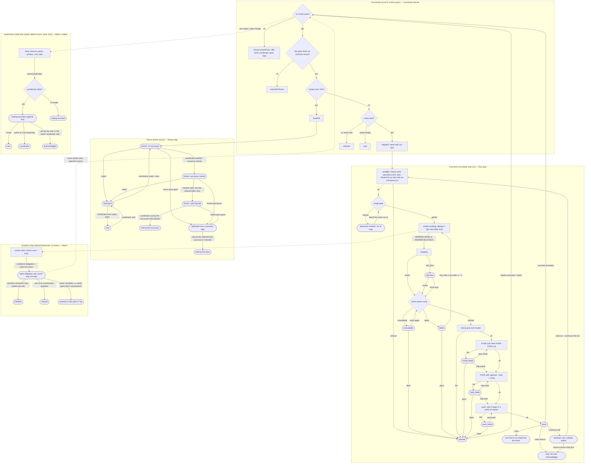
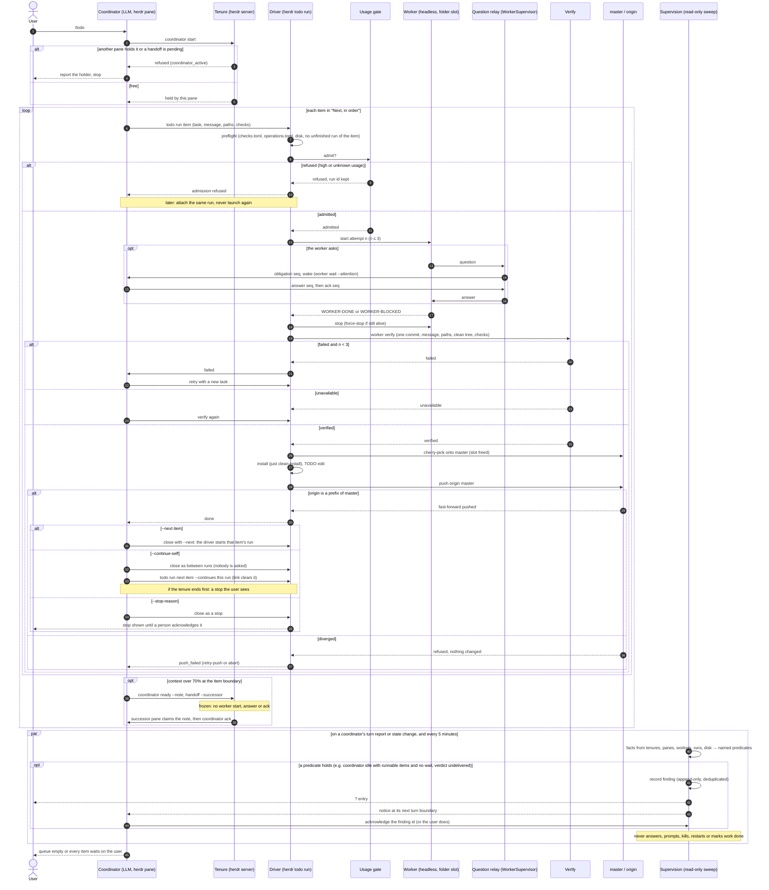
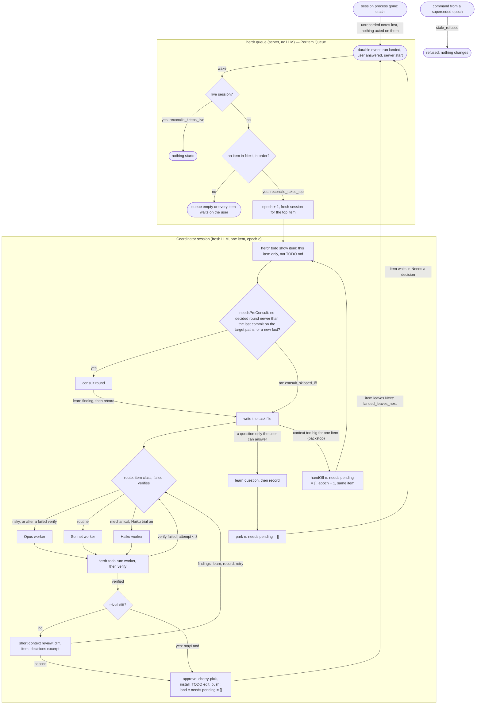
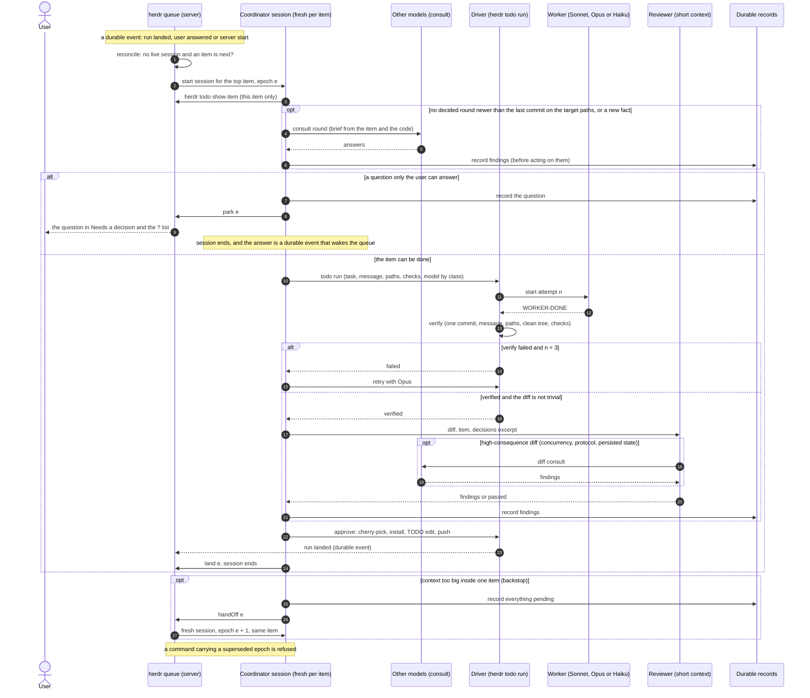

# TODO workflow model

A hand-written model of how a repository's TODO is worked through with herdr:
the coordination tenure and its handoff, one item's run through
`herdr todo run` and how a landed run is closed (`--next`, `--stop-reason`,
`--continue-self`), the relay of a worker's questions to its owner, the
read-only supervision that detects stuck coordinators and workers, and the
coordinator's decision at an item boundary.

**These proofs establish properties of this model only.** `TodoWorkflow.lean`
was written by hand on 2026-10-23 (at commit `8400a511e`; revised after consult rounds `20261023-133232-9be6`, `20261023-134902-c328`, `20261023-135828-a549`, `20261023-140629-1d9c`, `20261023-142050-c4f5`, `20261023-143108-0292`, `20261023-150255-21dc`, `20261023-150810-9b94` and `20261023-151322-2194`) from `AGENTS.md`,
`DECISIONS.md`, `.herdr/checks.toml`, the CLI help and the global `todo` and
`handoff` skills. It is not extracted from the Rust code, and nothing checks
that the code still matches it. The Rust code and its tests are the source of
truth; the diagram below only illustrates the model. Consult round
`20261023-132611-0125` chose this place and form.

## Check

```sh
lean docs/todo-workflow-model/TodoWorkflow.lean   # Lean 4.34.0, no Mathlib
```

It prints the one `#eval` (`TodoWorkflow.Action.dispatch "t-b"`) and nothing
else when every theorem holds. Lean is not part of `just check`.

## What it proves

Over any sequence of events, not just one step:

- Nothing lands (cherry-pick, install, TODO edit, push, done) without a
  `verified` verdict (`landing_needs_verified`, `done_needs_verified`), and
  landing is a trap: no step goes back to a worker or a verify
  (`landing_is_trap`, `landing_stays`).
- No run from preflight reaches a fourth attempt
  (`attempts_bounded_from_preflight`).
- A run's pending stop never disappears until a person acknowledges it
  (`stop_stays_until_user_ack`).
- A question a worker asks is never lost: its number stays an open
  obligation, goes to the user, or is answered and acknowledged
  (`question_never_lost`).
- At most one run holds the worker slot, from admission until its commit is
  cherry-picked (`one_worker`).
- Obligation numbers stay fresh: a new one never reuses a number that is
  open, escalated or handled (`seqs_fresh`).
- Neither origin's nor master's history is ever rewritten
  (`origin_only_grows`, `master_only_grows`).

For single steps:

- Only the holder ends a tenure; any tenure that is not free refuses a plain
  start; the holder names one successor, never itself; the note's claim is
  exclusive and only an allowed taker (not the frozen pane, and the named
  successor when there is one) can win it, so a wrong claim cannot block the
  handoff; only the named successor that won the claim acks; after the
  frozen pane is gone only the claimant takes over; a successor or claimant
  whose pane closes is forgotten, so the note can be claimed again.
- A refused admission waits for the same run's attach; a run id is never
  reused, and an item with an unfinished run is never launched again.
- `--continue-self`: a run between runs asks nobody; a run started with
  `--continues p` goes through only when `p` is between runs and owned by the
  same tenure, records the link and clears `p`; only a landed, still open
  run is closed; if the tenure ends first, the run becomes a stop the user
  sees; a coordinator never acknowledges a stop (`between_runs_asks_nobody`,
  `continues_is_explicit`, `continues_clears`, `close_only_done`,
  `tenure_end_surfaces`, `coordinator_cannot_ack_stop`). Decided in the
  model where the item leaves it open: the link stays within one tenure, one
  successor per predecessor, only a `done` run is closed, and
  `--continue-self` is refused after the tenure ended.
- A push goes through only as a fast-forward; one that is not changes
  nothing and waits as `push_failed` (a diverged origin is the user's to
  resolve; no rebase is modelled). The same commit never lands twice, on
  master or on origin.
- The question relay (part of `WorkerSupervisor`): obligations are numbered, and answers, escalations and
  acknowledgements name the number; every worker event wakes the owner and
  blocks its stop until acknowledged; an unanswered question cannot be
  acknowledged away; a stopped worker that exits by itself goes on to verify;
  when the owner goes away every unanswered question reaches the user, no
  obligation is left that only the gone owner could acknowledge, and later
  worker questions go straight to the user (`gone_owner_not_woken`).
- Supervision (the supervisor of the global rules): a finding is detected
  exactly when its named predicate holds, so an idle coordinator with
  runnable items and no known wait is detected; every detected finding has
  an open row after a sweep, and a new one is opened once and reaches the
  user's `?` list and its coordinator's notices; the ledger keeps every
  finding; an acknowledgement needs an open row and an agent cannot give
  one; a sweep changes only its ledger, never the tenure, the runs, the
  branches or the relay (`detect_iff`, `idle_coordinator_detected`,
  `sweep_records`, `new_finding_surfaces`, `sweep_keeps`, `ack_needs_open`,
  `agent_cannot_ack`, `supervise_never_acts`). Who acks as the herdr
  coordinator is a trusted input here. This proves detection of the
  named predicates, not of every way to be stuck.
- The coordinator dispatches only from its own pane holding an unfrozen
  tenure, and stops when the queue is empty.

Assumed, not proved: the content of the cherry-picked commit (herdr's verify
checks it), what the user does with an escalated question, and the composition of the parts (`Tenure`, `Repo`, `Git` and
`Watch` are separate machines, so a frozen tenure stopping worker starts is
not proved across them).

## Where it maps to the code

| Model | Code |
|---|---|
| `Tenure`, `Tenure.step` | `src/workers/coordinators.rs`, `src/workers/coordinator_handoff.rs`, `src/cli/coordinator.rs` |
| handoff note claim | `src/cli/handoff.rs` |
| `Run`, `Run.step` | `src/workers/runs/` (`finish.rs`: install, TODO edit, push), `src/cli/todo.rs` |
| verify | `src/workers/verify/`, `.herdr/checks.toml` |
| `Watch` (the question relay) | `src/workers/supervisor/questions.rs` (questions, escalation), worker wait/ack and the Stop hook |
| `Facts`, `detect`, `Ledger` (supervision) | `src/workers/supervision.rs`, `src/api/schema/supervision.rs` |
| `Repo`, `Disposition` | `src/workers/runs/`, the `--continue-self` item of `TODO.md` (not implemented yet) |
| `Coordinator.decide` | the global `todo` skill (agent-kit), not herdr code |
| `PerItem` | not implemented yet (the target design below; TODO items from 2026-10-23) |

`Watch` is the question relay, not the supervisor: the supervisor of the
global rules is supervision (`detect`, `Ledger`). Supervision also sweeps
every 5 minutes besides its events; whether that timer is allowed under the
rule against periodic catch-up is an open question for the user. Left out too: `todo wait`/`resume` events and
their acknowledgements, queue mode, `--close`/`--next` chaining, the counterfactual
check and auto-review.

## Keeping it current

A commit that changes tenure, handoff, dispatch, verify, landing or a failed
state updates the model and the diagram in the same commit, or says in its
message why they are unaffected. Then update the commit and date above.

`todo-workflow.svg` is the diagram below, rendered with plain SVG text labels
(so viewers without HTML-in-SVG show them). Re-render it whenever the
diagram changes:

```sh
echo '{"htmlLabels":false,"flowchart":{"htmlLabels":false}}' > config.json
npx -p @mermaid-js/mermaid-cli@11.4.2 mmdc -c config.json -i diagram.mmd -o todo-workflow.svg -b white
```

with the block below saved as `diagram.mmd`, and commit both.

## Diagram



## Sequence

The same workflow as messages between the parts, over one TODO item
(`todo-sequence.svg`, rendered like the diagram above):



## Target design: a fresh coordinator session per item

Not implemented yet. Decided by the user on 2026-10-23 ("implement the best
solution") after the consult rounds named in `cost-baseline.md`, which also
holds the measured baseline and the estimates this design is checked
against. `PerItem` in `TodoWorkflow.lean` models it:

- herdr's queue starts a fresh coordinator session for the top item on a
  durable event (a run landed, the user answered, server start); the start
  is a pure function of durable state, so a lost wake only delays it and a
  repeated one starts nothing more (`reconcile_idem`,
  `reconcile_starts_iff`, `reconcile_keeps_live`, `reconcile_takes_top`);
- every start advances the tenure epoch; the live session holds the current
  epoch and a command from a superseded one changes nothing (`exec_wf`,
  `stale_refused`);
- a session lands its item, parks it for the user, or hands off (a backstop
  for a huge item) only once everything it learned (open questions,
  consult findings) is recorded; durable records only grow; a landed item
  leaves "Next, in order" (`acts_need_recorded`, `records_only_grow`,
  `landed_leaves_next`);
- workers are Sonnet by default, Opus for risky items and after any failed
  verify, Haiku only for a first attempt at a mechanical item during its
  trial (`route_risky`, `route_after_failure`, `haiku_only_on_trial`);
- nothing lands unverified, and a non-trivial diff lands only after the
  short-context review (`mayLand_needs_verified`, `nontrivial_needs_review`);
- a pre-task consult is skipped exactly when the item's decided round is
  newer than the last commit on its target paths and nothing new came up
  (`consult_skipped_iff`).

Assumed, not proved: a crash loses only notes that were never recorded and
that nothing acted on; how an item's class is chosen; what the review finds.
`per-item-workflow.svg` and `per-item-sequence.svg` are rendered from the
two blocks below like the diagrams above.




