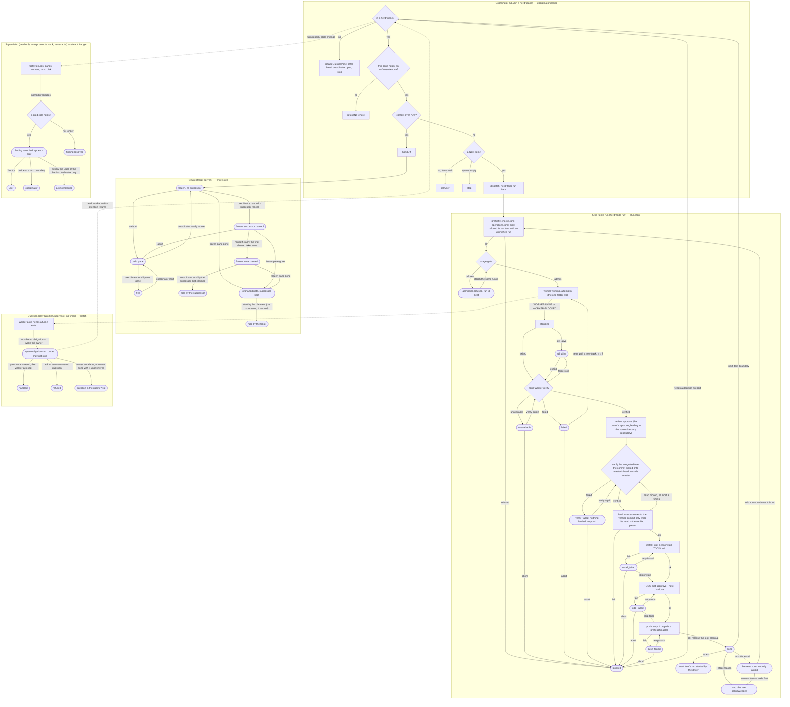
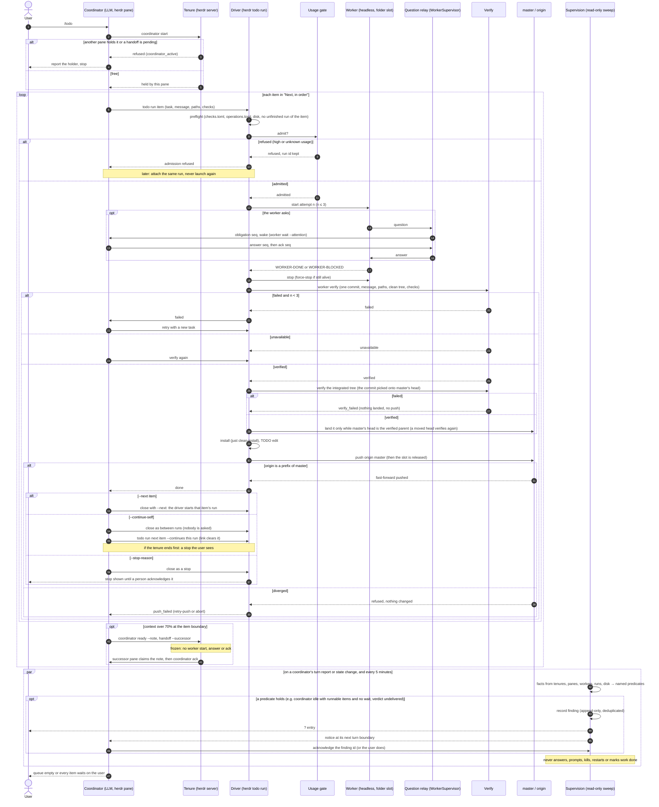
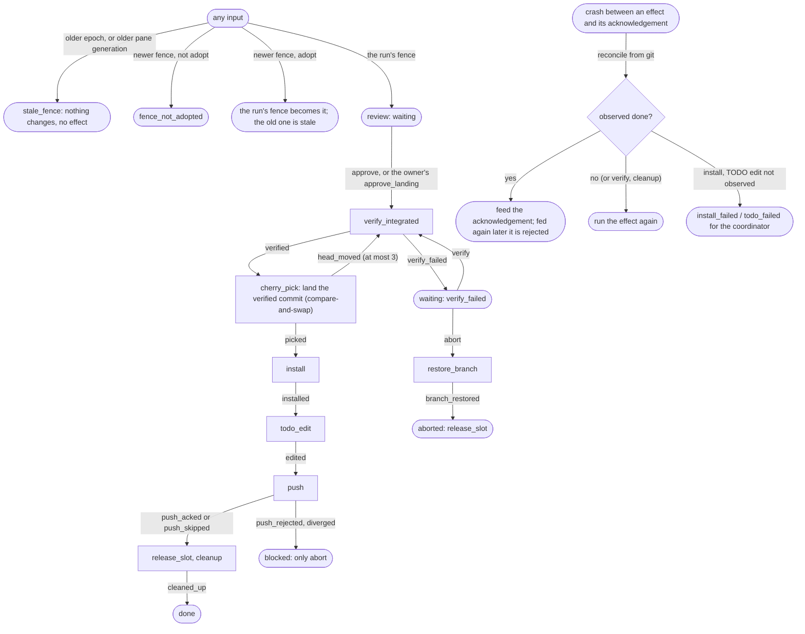
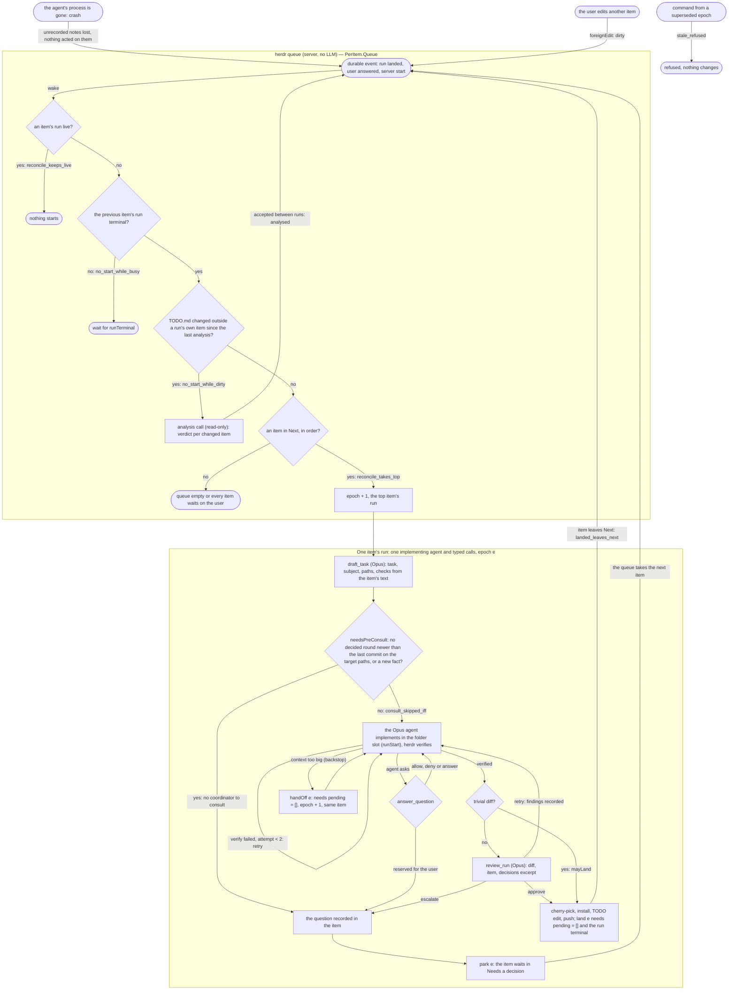
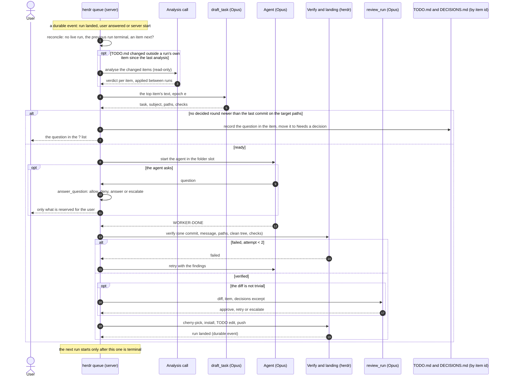

# TODO workflow model

A hand-written model of how a repository's TODO is worked through with herdr:
the coordination tenure and its handoff, one item's run through
`herdr todo run` and how a landed run is closed (`--next`, `--stop-reason`,
`--continue-self`), the relay of a worker's questions to its owner, the
read-only supervision that detects stuck coordinators and workers, the
coordinator's decision at an item boundary, and the landing's transition core
(`Landing`: the coordinator fence, effect acknowledgements and the landing
order, as `src/workers/runs/core.rs` implements them), with JSON traces that
a Rust test replays on that core.

**These proofs establish properties of this model only.** `TodoWorkflow.lean`
was written by hand on 2026-10-23 (at commit `8400a511e`; revised after consult rounds `20261023-133232-9be6`, `20261023-134902-c328`, `20261023-135828-a549`, `20261023-140629-1d9c`, `20261023-142050-c4f5`, `20261023-143108-0292`, `20261023-150255-21dc`, `20261023-150810-9b94` and `20261023-151322-2194`) from `AGENTS.md`,
`DECISIONS.md`, `.herdr/checks.toml`, the CLI help and the global `todo` and
`handoff` skills. It is not extracted from the Rust code. Only `Landing` is
checked against the code: it was written on 2026-10-24 (at commit
`53eb341cc`) as a one-to-one model of `core::step` and `core::reconcile`, and
its traces are replayed on the Rust core by `cargo nextest` (see "Traces");
nothing checks the other parts against the code. The Rust code and its tests
are the source of truth; the diagram below only illustrates the model. Consult round
`20261023-132611-0125` chose this place and form.

## Check

```sh
lean docs/todo-workflow-model/TodoWorkflow.lean   # Lean 4.34.0, no Mathlib
```

It prints nothing when every theorem and `#guard` holds (about 20 s); no
proof uses `sorry`. Lean is not part of `just check`; the replay of the
committed traces is.

## Traces

`traces/*.json` are traces of the landing core in format v1 (described in
`src/workers/runs/core.rs`): an initial state and a script of inputs and
observations, each step with what the Lean model computes (the rejection, or
the whole next state and the effects; the reconcile of an observation). The
Rust test `workers::runs::core::tests::lean_model_traces_replay` feeds every
committed trace to the real `core::step` and `core::reconcile` and compares
each step, so `just check` fails when the Rust core no longer does what the
model does. The traces: `happy-landing`, `crash-after-landing-before-ack`,
`crash-after-push-before-ack` (a crash between an effect and its persisted
acknowledgement, then the restart's reconcile and the acknowledgement fed
again), `stale-fence-and-pane` (an older tenure epoch, an older pane
generation, a newer fence before and after its adoption),
`verify-failed-no-push` and `head-moved-reverify`. They are defined at the end
of `TodoWorkflow.lean` (`Landing.traces`). Regenerate them after changing the
model, and check that the committed ones are current, from the repository
root:

```sh
lean --run docs/todo-workflow-model/TodoWorkflow.lean docs/todo-workflow-model/traces
lean --run docs/todo-workflow-model/TodoWorkflow.lean --check docs/todo-workflow-model/traces
```

The second exits 1 naming each trace that differs. The hand-written traces
under `tests/fixtures/todo-traces/` are replayed by `traces_replay` the same
way.

## What it proves

Over any sequence of events, not just one step:

- Nothing lands (cherry-pick, install, TODO edit, push, done) without a
  `verified` verdict (`landing_needs_verified`, `done_needs_verified`), and
  landing is a trap: no step goes back to a worker or a verify
  (`landing_is_trap`, `landing_stays`).
- No run from preflight reaches a fourth attempt
  (`attempts_bounded_from_preflight`).
- A run's pending stop never disappears until a person acknowledges it
  (`stop_stays_until_user_ack`).
- A question a worker asks is never lost: its number stays an open
  obligation, goes to the user, or is answered and acknowledged
  (`question_never_lost`).
- At most one run holds the worker slot, from admission until its push is
  acknowledged or the run ends (`one_worker`; `Run.busy` follows the core's
  `slot_held`).
- Obligation numbers stay fresh: a new one never reuses a number that is
  open, escalated or handled (`seqs_fresh`).
- Neither origin's nor master's history is ever rewritten
  (`origin_only_grows`, `master_only_grows`).

For single steps:

- Only the holder ends a tenure; any tenure that is not free refuses a plain
  start; the holder names one successor, never itself; the note's claim is
  exclusive and only an allowed taker (not the frozen pane, and the named
  successor when there is one) can win it, so a wrong claim cannot block the
  handoff; only the named successor that won the claim acks; after the
  frozen pane is gone only the claimant takes over; a successor or claimant
  whose pane closes is forgotten, so the note can be claimed again.
- A refused admission waits for the same run's attach; a run id is never
  reused, and an item with an unfinished run is never launched again.
- `--continue-self`: a run between runs asks nobody; a run started with
  `--continues p` goes through only when `p` is between runs and owned by the
  same tenure, records the link and clears `p`; only a landed, still open
  run is closed; if the tenure ends first, the run becomes a stop the user
  sees; a coordinator never acknowledges a stop (`between_runs_asks_nobody`,
  `continues_is_explicit`, `continues_clears`, `close_only_done`,
  `tenure_end_surfaces`, `coordinator_cannot_ack_stop`). Decided in the
  model where the item leaves it open: the link stays within one tenure, one
  successor per predecessor, only a `done` run is closed, and
  `--continue-self` is refused after the tenure ended.
- A push goes through only as a fast-forward; one that is not changes
  nothing and waits as `push_failed` (a diverged origin is the user's to
  resolve; no rebase is modelled). The same commit never lands twice, on
  master or on origin.
- The question relay (part of `WorkerSupervisor`): obligations are numbered, and answers, escalations and
  acknowledgements name the number; every worker event wakes the owner and
  blocks its stop until acknowledged; an unanswered question cannot be
  acknowledged away; a stopped worker that exits by itself goes on to verify;
  when the owner goes away every unanswered question reaches the user, no
  obligation is left that only the gone owner could acknowledge, and later
  worker questions go straight to the user (`gone_owner_not_woken`).
- Supervision (the supervisor of the global rules): a finding is detected
  exactly when its named predicate holds, so an idle coordinator with
  runnable items and no known wait is detected; every detected finding has
  an open row after a sweep, and a new one is opened once and reaches the
  user's `?` list and its coordinator's notices; the ledger keeps every
  finding; an acknowledgement needs an open row and an agent cannot give
  one; a sweep changes only its ledger, never the tenure, the runs, the
  branches or the relay (`detect_iff`, `idle_coordinator_detected`,
  `sweep_records`, `new_finding_surfaces`, `sweep_keeps`, `ack_needs_open`,
  `agent_cannot_ack`, `supervise_never_acts`). Who acks as the herdr
  coordinator is a trusted input here. This proves detection of the
  named predicates, not of every way to be stuck.
- The coordinator dispatches only from its own pane holding an unfrozen
  tenure, and stops when the queue is empty.

The landing core (`Landing`), for one run, over any inputs from its review
(`exec_inv`, from `Inv.init`) and for every single step:

- The fence (tenure epoch, pane generation): an input from an older epoch, or
  from an older pane generation in the same epoch, is rejected
  (`stale_fence_rejected`, `older_epoch_rejected`, `older_pane_rejected`); a
  newer fence is rejected until it adopts the run (`unadopted_fence_rejected`),
  an adoption has no effect and fences out the fence it replaced
  (`adopt_fences_out`, `fence_monotone`); every effect comes from an input
  with the run's own fence (`effects_need_current_fence`).
- The landing order: `cherry_pick` (the landing) is an effect only of a
  `verified` acknowledgement of the integration commit, which it lands, with
  nothing of the run on the branch yet (`land_needs_verified`,
  `integrated_only_verified`); a commit on the branch was verified on the
  integrated tree (`picked_was_verified`); a moved head drops the verified
  commit and verifies again or stops (`head_moved_reverifies`); `push` is an
  effect only after a verified commit landed, also when a crash runs it
  again (`push_needs_verified`, `rerun_push_needs_verified`); a failed verify
  waits with no push and nothing landed (`verify_failed_no_push`).
- The slot: `release_slot` is an effect only of an acknowledged or skipped
  push or of the abort that ends the run (`release_only_after_push_or_abort`);
  the slot is freed only with that effect and never taken back
  (`slot_freed_by_release`, `slot_never_retaken`); a free slot or a done run
  means the push happened or was skipped, or the run aborted
  (`slot_free_after_push_or_abort`, `done_after_push`).
- Effect acknowledgements (an effect may succeed before its acknowledgement
  persists): after a crash the reconcile acknowledges an effect it observes
  done, never runs it again (`reconcile_acks_done`); it runs again only an
  effect observed as not done, or the verify and the cleanup, and an install
  or TODO edit not observed becomes a failure for the coordinator
  (`reconcile_reruns_only_undone`); so the landing and the push never happen
  twice (`no_second_landing`, `no_second_push`); the derived acknowledgement
  is one of the pending effect and applies (`reconcile_ack_of_pending`,
  `reconcile_ack_applies`); an acknowledgement fed again after it was
  persisted is rejected, with any input id (`ack_applies_once`).

Assumed, not proved: that the shell observes git correctly (`Observed`), that
the verify and the cleanup are safe to repeat, the content of the cherry-picked commit (herdr's verify
checks it), what the user does with an escalated question, and the composition of the parts (`Tenure`, `Repo`, `Git` and
`Watch` are separate machines, so a frozen tenure stopping worker starts is
not proved across them).

## Where it maps to the code

| Model | Code |
|---|---|
| `Tenure`, `Tenure.step` | `src/workers/coordinators.rs`, `src/workers/coordinator_handoff.rs`, `src/cli/coordinator.rs` |
| handoff note claim | `src/cli/handoff.rs` |
| `Run`, `Run.step` | `src/workers/runs/` (`finish.rs`: install, TODO edit, push), `src/cli/todo.rs` |
| verify | `src/workers/verify/`, `.herdr/checks.toml` |
| `Watch` (the question relay) | `src/workers/supervisor/questions.rs` (questions, escalation), worker wait/ack and the Stop hook |
| `Facts`, `detect`, `Ledger` (supervision) | `src/workers/supervision.rs`, `src/api/schema/supervision.rs` |
| `Repo`, `Disposition` | `src/workers/runs/`, the `--continue-self` item of `TODO.md` (not implemented yet) |
| `Coordinator.decide` | the global `todo` skill (agent-kit), not herdr code |
| `PerItem` | not implemented yet (the target design below; TODO items from 2026-10-23) |
| `Landing.step`, `Landing.reconcile` | `src/workers/runs/core.rs` (`step`, `reconcile`), run by the shell in `src/workers/runs/landing.rs`; the fence is always `(0, 0)` there and nothing sends `adopt` (the tenure fence wiring, t-ic5rrxn3, is not implemented) |

`Watch` is the question relay, not the supervisor: the supervisor of the
global rules is supervision (`detect`, `Ledger`). Supervision also sweeps
every 5 minutes besides its events; whether that timer is allowed under the
rule against periodic catch-up is an open question for the user. Left out too: `todo wait`/`resume` events and
their acknowledgements, queue mode, `--close`/`--next` chaining, the counterfactual
check and auto-review.

## Keeping it current

A commit that changes tenure, handoff, dispatch, verify, landing or a failed
state updates the model and the diagram in the same commit, or says in its
message why they are unaffected. Then update the commit and date above. A
change to `src/workers/runs/core.rs` updates `Landing` and regenerates the
traces; `lean_model_traces_replay` fails when the core and the committed
traces disagree, and `--check` when the traces and the model do.

`todo-workflow.svg` is the diagram below, rendered with plain SVG text labels
(so viewers without HTML-in-SVG show them). Re-render it whenever the
diagram changes:

```sh
echo '{"htmlLabels":false,"flowchart":{"htmlLabels":false}}' > config.json
npx -p @mermaid-js/mermaid-cli@11.4.2 mmdc -c config.json -i diagram.mmd -o todo-workflow.svg -b white
```

with the block below saved as `diagram.mmd`, and commit both.

## Diagram



## Sequence

The same workflow as messages between the parts, over one TODO item
(`todo-sequence.svg`, rendered like the diagram above):



## The landing core

`Landing.step` (`src/workers/runs/core.rs`); every arrow is an input with the
run's fence, every box's effect waits for its acknowledgement:



## Target design: queue mode, one agent per item

Not implemented yet. Decided by the user on 2026-10-23 ("implement the best
solution"; "if TODO.md is not dirty, the supervisor gives the first item,
then the next"; "there will be only one agent, no workers"; drafting and
review on Opus; "only Opus") after the consult rounds named in `cost-baseline.md`, which
also holds the measured baseline and the estimates this design is checked
against, and rounds `20261023-215510-0b94` and `20261023-221441-3128`. There
is no coordinator LLM: herdr's queue mode (`herdr todo queue on`, built,
not yet trialled) starts each item's run, one agent implements it, and the
model is called only in typed calls (`draft_task`, `answer_question`,
`review_run`). `PerItem` in `TodoWorkflow.lean` models it, a `Session`
there being one item's run:

- the queue starts the top item's run on a durable event (a run landed,
  the user answered, server start); the start is a pure function of
  durable state, so a lost wake only delays it and a repeated one starts
  nothing more (`reconcile_idem`, `reconcile_starts_iff`,
  `reconcile_keeps_live`, `reconcile_takes_top`);
- no run starts while the previous item's run is not terminal, or while
  TODO.md has a change outside a run's own item that the last accepted
  analysis did not see; the analysis is accepted only between runs, and a
  run's own commands never mark TODO.md dirty (`no_start_while_busy`,
  `no_start_while_dirty`, `analysed_between_sessions`,
  `own_commands_keep_clean`);
- every start advances the epoch; a command from a superseded run changes
  nothing (`exec_wf`, `stale_refused`);
- a run lands its item (only once terminal), parks it for the user, or
  hands off (a backstop for a huge item) only once every question and
  finding is recorded in TODO.md or DECISIONS.md by item id; records only
  grow; a landed item leaves "Next, in order" (`acts_need_recorded`,
  `land_needs_terminal`, `records_only_grow`, `landed_leaves_next`);
- the agent and both calls run on Opus only (no routing to cheaper models);
- nothing lands unverified, and a non-trivial diff lands only after
  `review_run` approved it (`mayLand_needs_verified`,
  `nontrivial_needs_review`);
- an item whose decided round is not newer than the last commit on its
  target paths, or with a new fact, waits on the user: with no coordinator
  nobody runs a consult round (`consult_skipped_iff`).

Assumed, not proved: a crash loses only notes that were never recorded and
that nothing acted on; how "a change outside a run's own item" is detected
(per-item hashes against the last analysed ones); what the analysis and the review find.
`per-item-workflow.svg` and `per-item-sequence.svg` are rendered from the
two blocks below like the diagrams above.




